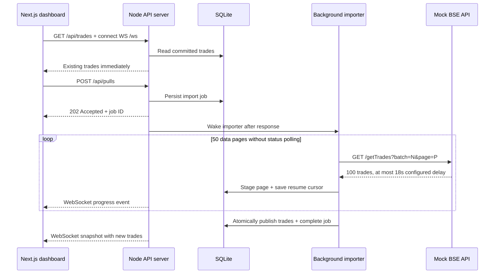
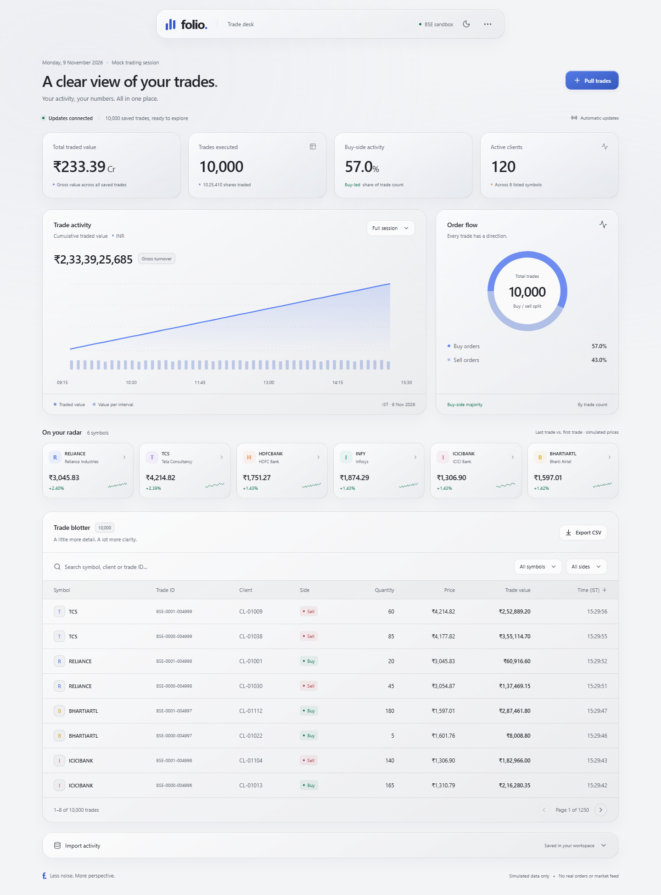

# Folio — BSE Trade Import Assessment

Implementation of the Software Engineer technical assessment: a mock BSE API and a dashboard that displays saved trades immediately and receives new trades automatically when an import completes.

All records are synthetic. No real exchange connection or order execution is included.

## Problem statement

A full trade pull can take up to 15 minutes, while the network terminates HTTP connections held open longer than 30 seconds. The dashboard must remain available during a pull and update on completion without a page refresh, polling loop or cron scheduler.

## Implementation

| Requirement | Implementation |
| --- | --- |
| Mock `GET /getTrades` | 5,000 deterministic records with configurable delay up to 15 minutes |
| Dashboard opens during a pull | Reads previously committed trades from SQLite |
| Automatic completion updates | WebSocket progress events and a completed trade snapshot |
| No polling or cron | An event starts the importer; unfinished jobs resume on startup |
| Documentation | Setup instructions, architecture diagram and demo video below |

The dashboard also provides search, symbol/side filters, sorting, pagination, CSV export, import history and visible progress.

## Review tools

### Session replay

Select **Start replay** to review a fixed snapshot of saved trades. Play/pause, change speed or scrub to an IST timestamp; totals, charts, symbol cards and the blotter follow the same playhead. New imports continue in the background and are included when you return to all trades. Blotter CSV exports respect the replay scope.

### Trade inspection

Select a trade ID to inspect its execution time, quantity, price and gross value. The detail dialog includes client activity and the symbol's quantity-weighted executed price within the current review scope. **View client trades** focuses the blotter on that client. Opening a trade pauses replay for a stable review.

### Advanced filters and saved views

Open **More filters** in the blotter to filter by client, minimum/maximum trade value in INR and an inclusive IST time range. Save up to ten named views, including search, symbol and side filters; apply or delete them later. Views stay in this browser and can be reused after reload. Invalid ranges show a validation message. CSV exports use the complete filtered result, not only the visible page.

### Session insights

Expand **Session insights** to see symbol turnover concentration, quantity-weighted executed prices, the five most active clients by gross turnover, and buy/sell totals. These figures use the same saved-session or replay scope as the dashboard. They describe executed trades, not holdings, investment signals or profit/loss. Concentration bars animate on expansion and respect reduced-motion preferences.

### Import verification and batch export

Expand **Import verification** to select a completed import, reconcile its inserted count against saved records, check duplicate IDs and compare turnover/quantity with the previous completed batch. **Export batch CSV** downloads only that batch. Verification always uses the full saved dataset, even during replay. Batch membership follows the mock API's deterministic trade-ID prefix; it is a record-count check, not exchange certification. Session insights and import verification are also available from **Workspace options**.

## Demo video

A 90-second walkthrough of the problem, dashboard, import flow and APIs. Use the player's volume control to enable narration.

https://github.com/user-attachments/assets/0d169ed4-6eda-4d11-86f6-11360180a98b

[Download the video](docs/folio-launch.mp4)

## Setup

Requires npm and Node.js 22.13+ on the 22.x line, or Node.js 24+. Tested on Windows with Node.js 22.23.4. Node 22 may display an experimental warning for its built-in SQLite module.

```sh
git clone https://github.com/vinitgirdhar/folio.git
cd folio
npm ci
npm run dev
```

Open [http://127.0.0.1:3000](http://127.0.0.1:3000). The application creates `data/folio.sqlite` and seeds 5,000 trades across 6 symbols and 120 clients. No database service or API key is required.

For a production build:

```sh
npm run build
npm start
```

Copy `.env.example` to `.env` to override the defaults. Restart the server after changing configuration.

| Variable | Default | Purpose |
| --- | --- | --- |
| `PORT` | `3000` | HTTP and WebSocket server port |
| `HOST` | `127.0.0.1` | Bind address; `0.0.0.0` is also supported |
| `DATABASE_PATH` | `./data/folio.sqlite` | Persistent SQLite database |
| `MOCK_DELAY_MS` | `12000` | Default pull duration, from `0` to `900000` milliseconds |

The dashboard offers instant, 12-second, 35-second and 15-minute imports.

## Verify the assessment flow

1. Open the dashboard in two tabs. Both display saved trades.
2. Select **Pull trades → 35 seconds → Start pull**. The start request returns HTTP 202 immediately.
3. Search or filter existing trades while progress updates arrive. Open another tab during the pull to confirm saved data remains available.
4. On completion, every open dashboard receives 5,000 additional trades automatically.
5. Select the 15-minute duration to exercise the maximum configured delay.
6. To check recovery, stop the server during a pull and restart it against the same database. The importer resumes from its saved cursor.

The 35-second option demonstrates an import that outlasts the simulated HTTP lifetime. A full, unpaginated `/getTrades` request with that delay is terminated at the 30-second cutoff.

## Architecture

**Stack:** Next.js, React and TypeScript for the dashboard; a custom Node.js HTTP server, SQLite storage and WebSockets for import processing and delivery.



The application, API and importer run in one always-on Node process. SQLite keeps committed trades, staged pages and import jobs on persistent disk.

- **Independent reads:** saved trades remain available while incoming pages are staged separately.
- **Durable progress:** each page and its resume cursor are saved together.
- **Atomic publication:** the completed batch becomes visible in one transaction. Failed imports preserve existing trades.
- **Duplicate protection:** deterministic trade IDs prevent duplicate inserts, and concurrent start requests reuse the running job.
- **Live delivery:** WebSockets push progress and completion. Reconnecting clients receive a current snapshot.

### Network assumptions

The mock retains the requested slow full-export endpoint and adds pagination on that same endpoint. The importer reads 50 pages of 100 records, dividing the configured delay across them. At the 15-minute setting, each page has an 18-second configured delay. These requests retrieve data; they do not poll job status.

This design assumes the upstream supports bounded paginated reads from an immutable snapshot and the network permits persistent WebSocket connections. If the real upstream only provides one blocking 15-minute HTTP response, pagination, an asynchronous export/callback, or a network change is required. A background worker alone cannot bypass an absolute connection deadline.

[Detailed architecture and failure handling](docs/ARCHITECTURE.md)

## API reference

Base URL: `http://127.0.0.1:3000`.

| Endpoint | Behavior |
| --- | --- |
| `GET /getTrades?delayMs=12000&batch=1` | Returns 5,000 seeded trades after the requested delay; subject to the 30-second cutoff |
| `GET /getTrades?delayMs=900000&batch=1&page=0` | Returns 100 trades from a fixed batch; page indices are `0`–`49` |
| `GET /api/trades` | Returns committed trades, the latest 20 imports and the total trade count |
| `POST /api/pulls` | Starts an import; optional JSON body: `{ "delayMs": 12000 }`; returns HTTP 202 and a job ID |
| `GET /api/pulls/:id` | Returns job details for manual inspection; the dashboard does not poll this endpoint |
| `WS /ws` | Delivers an initial snapshot, progress events and the completed trade snapshot |

Trade fields: `id`, `client`, `symbol`, `side`, `quantity`, `pricePaise`, `timestamp`. Prices are stored as integer paise; timestamps are ISO UTC and displayed in IST. Charts and totals come from saved records. The dataset represents a fixed simulated session; turnover is gross trade value, not portfolio value or profit/loss.

## Tests and verification

```sh
npm run typecheck
npm run lint
npm test
npm run build
npx playwright install chromium
npm run test:e2e
npm audit
```

Playwright starts a production server on port 3100 with a separate test database. Tests cover API validation, import persistence and recovery, live delivery to multiple tabs, response ordering, dashboard interactions and mobile layouts.

Recorded verification includes 26 unit/integration tests, 19 Chromium browser tests and a completed 15-minute mock import. See [verification results and limits](docs/VERIFICATION.md) and the [requirement checklist](docs/ASSIGNMENT_AUDIT.md).

## Project structure

```text
server.ts              HTTP routes, WebSocket transport and startup
src/server/mock.ts     Seeded exchange simulator and validation
src/server/store.ts    SQLite storage, staging and durable job state
src/server/importer.ts Background page consumer and recovery
src/shared/types.ts    Shared data contracts
src/app/               Next.js application entry points
src/components/        Dashboard, charts and controls
tests/                 Unit, integration and browser tests
docs/                  Architecture, verification and demo video
```

## Runtime scope

Run one application process with a persistent local disk. This implementation is not intended for ephemeral serverless functions or multiple replicas sharing a SQLite file. Public deployment would require authentication, HTTPS, WebSocket proxy support and operational controls. Real BSE integration and production deployment are outside this assessment.

## Dashboard



## Credits

Third-party component licences are preserved in [THIRD_PARTY_NOTICES.md](THIRD_PARTY_NOTICES.md).

Demo music: “Happy Beats / Business Moves Vol. 12” by Sascha Ende, [ende.app](https://ende.app/en), [CC BY 4.0](https://creativecommons.org/licenses/by/4.0/). Trimmed and faded beneath the narration.
