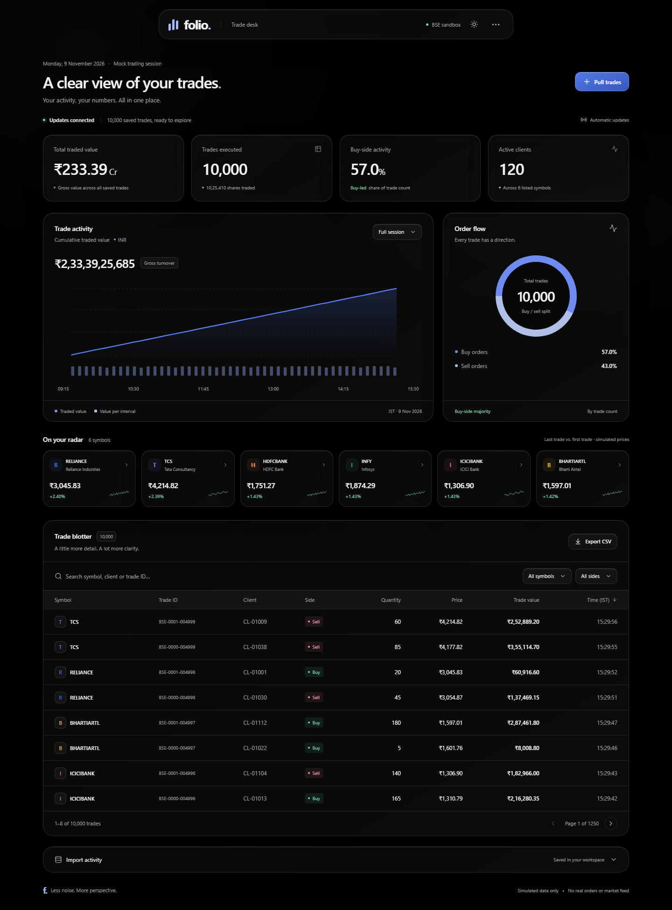

# Folio · Trade desk

A responsive, Apple-inspired BSE trading dashboard for the software engineer assessment. Next.js + React + TypeScript, a persistent SQLite database, background imports, WebSocket updates, and GSAP motion. Light and true-black themes, liquid-glass surfaces, derived charts, search/filter/pagination, CSV export, and import history are included.

**All records and prices are synthetic. This app does not place orders or connect to the real BSE.**


<details>
<summary>Dark mode preview</summary>



</details>

The glass optics reuse [deepika-builds/liquid-glass](https://github.com/deepika-builds/liquid-glass), vendored at a pinned commit with its MIT licence preserved. [Third-party notice](THIRD_PARTY_NOTICES.md) describes the integration and browser fallback. No CDN or extra runtime dependency is required.

The floating toolbar's **Workspace options** menu holds import history, full CSV export and help. Import history is collapsed by default. Every dropdown is custom styled and supports arrows, Home/End, typeahead, Enter, Escape and outside dismissal. The time header sorts the table. Scrollbars are hidden while touch, trackpad and keyboard scrolling remain available; overflowing tables show edge fades, an animated discovery hint and functional left/right controls. Reduced-motion preferences disable the motion.

During an import, a prominent activity card shows an animated ring, waveform and progress bar using the actual server percentage. **Pull in progress**, the toolbar indicator and **View progress** open a larger live view. The dashboard stays usable; disconnection pauses the activity animation and labels the last confirmed progress. Completion turns the card green with the number of added trades and a dismiss control.

The [assignment compliance audit](docs/ASSIGNMENT_AUDIT.md) maps every required item to its implementation and evidence. A [Trading Session Replay proposal](docs/NEXT_FEATURE.md) is kept separate; no extra product feature is implemented in this baseline.

## Run locally

Requires Node **22.13+ on the 22.x line, or Node 24+** and npm. Tested on Node 22.23.4 / Windows. Node 22's built-in SQLite emits an experimental warning; this is expected.

```sh
npm ci
npm run dev
```

Open [http://127.0.0.1:3000](http://127.0.0.1:3000). The database is created at `data/folio.sqlite` and seeded with **5,000 trades, 6 symbols, and 120 clients**. No database service, API key, or account is needed.

For a production build:

```sh
npm run build
npm start
```

Optional configuration: copy `.env.example` to `.env`. `MOCK_DELAY_MS` sets the default duration from `0` to `900000` milliseconds. `PORT`, `HOST` (`127.0.0.1` or `0.0.0.0`), and `DATABASE_PATH` are also configurable. The pull dialog offers instant, 12-second, 35-second, and 15-minute demonstrations without changing configuration. Server-side edits require restarting `npm run dev`; Next.js hot-reloads the frontend.

## Demonstrate the assignment

1. Open the dashboard in two browser tabs. Both immediately read the previously saved trades.
2. Select **Pull trades → 35 seconds → Start pull**. Acceptance returns HTTP 202 immediately.
3. Keep searching or filtering. Open a third tab during the import; it also sees the existing dataset.
4. When the import completes, all tabs show 5,000 additional trades automatically. No refresh, status polling, or scheduler is used.
5. Repeat with **15 minutes** if desired. Every upstream data request takes at most 18 seconds, plus local processing overhead.
6. For crash recovery, start a pull, stop the server partway through, and start it again. The saved cursor resumes the unfinished pull. Do not delete the database.

## The important network assumption

The screenshot specifies an upstream pull that may take 15 minutes and a network that kills **every HTTP connection older than 30 seconds**. A single delayed HTTP response cannot complete under both conditions. Putting the same request in a queue, increasing a client timeout, sending SSE heartbeats, or using `async/await` does not remove an absolute network deadline.

This repository preserves the requested **slow `GET /getTrades`** endpoint and also supplies an explicit **paginated extension on that same endpoint**. The importer consumes 50 actual data pages, each containing 100 records, with the total configured delay divided across the pages. It never polls a job status endpoint. The server enforces a 30-second HTTP response lifetime to demonstrate why the legacy full request fails but paginated import works.

**For a real exchange, confirm that pagination with a stable snapshot is available. If it only offers one blocking 15-minute response, the upstream must provide an asynchronous export/callback or the network must allow that request. This implementation does not claim to solve an impossible upstream contract unchanged.** Browser WebSockets also require the network to permit HTTP upgrades and persistent upgraded connections.

## API

| Endpoint | Behavior |
| --- | --- |
| `GET /getTrades?delayMs=12000&batch=1` | Full mock export: 5,000 deterministic trades after the requested delay. At durations ≥30 seconds the demo network cutoff terminates it. |
| `GET /getTrades?delayMs=900000&batch=1&page=0` | Paginated mock export: 100 deterministic trades, 18-second delay; pages `0`–`49`. A fixed batch identifies an immutable snapshot. |
| `GET /api/trades` | Immediate saved trades, latest 20 pulls, and total. Unaffected by staged imports. |
| `POST /api/pulls` | JSON body `{ "delayMs": 12000 }` (optional). Durable job, HTTP 202, `Location` header. Concurrent requests reuse the active job. |
| `GET /api/pulls/:id` | Manual inspection/debugging; **never polled by the dashboard**. |
| `WS /ws` | Initial authoritative snapshot; progress events; complete snapshot after commit. Reconnection gets a fresh snapshot. |

Trade schema: `id`, `client`, `symbol`, `side`, `quantity`, `pricePaise`, `timestamp`. Integer paise avoid floating-point storage of prices; quantities are integral shares and timestamps are ISO UTC, displayed in IST. Gross turnover is a sum of trade notionals, not portfolio value or P&L. Symbol changes compare the first and latest saved trade for that symbol. The chart shows cumulative gross turnover, with turnover bars per interval. The date is intentionally the fixed mock session, not live exchange time.

## Verification

```sh
npm run typecheck
npm run lint
npm test
npm run build
npx playwright install chromium
npm run test:e2e
npm audit
```

Playwright starts the production server on port 3100 with a separate test database. Its suite tests browser interactions, light/dark mobile layouts, live delivery to multiple tabs, no status polling, API validation, and a real 35-second import under the 30-second request cutoff. Screenshots are written to `artifacts/`. The 15-minute maximum is checked arithmetically in the unit suite; see `docs/VERIFICATION.md` for the actual executed checks and limits.

## Structure

```text
server.ts                       HTTP endpoints + WebSocket transport + startup
src/server/mock.ts              Deterministic exchange simulator and validation
src/server/store.ts             SQLite read model, staging, durable job state
src/server/importer.ts          Resumable background data-page consumer
src/shared/types.ts             Shared data contract
src/components/Dashboard.tsx    Dashboard and interaction state
src/components/ActivityChart.tsx SVG charts from stored records
src/components/Dropdown.tsx      Keyboard-accessible custom selection popover
src/components/ScrollRegion.tsx Hidden-scrollbar table with directional controls
src/components/WorkspaceMenu.tsx Compact workspace actions
src/components/LiquidGlassEffects.tsx React lifecycle for the vendored glass API
public/vendor/                  Original liquid-glass source + MIT notice
src/app/                       Next.js App Router and responsive theme CSS
tests/                         Unit/integration and browser checks
docs/ARCHITECTURE.md            Short design note and diagram
docs/RESEARCH.md                Sourced research and engineering decisions
```

## Deployment boundary

Run **one always-on Node process on a host with a persistent local disk**. A single SQLite job slot and process-local WebSocket fan-out deliberately keep this assignment small. Do not run multiple application replicas against the same file or deploy this version as ephemeral serverless functions. Back up the database safely, including WAL considerations; stop the process before a simple file copy.

The app binds to loopback by default and is an unauthenticated synthetic-data assessment. Public deployment would require authentication/authorization, HTTPS and WebSocket proxy configuration, rate limits, retention, monitoring, and backups. For larger datasets, move filtering/paging and aggregation to SQL instead of sending the full read model to every browser. For multiple replicas, use a dedicated worker, PostgreSQL and a shared event transport. These are intentionally outside this assignment.
