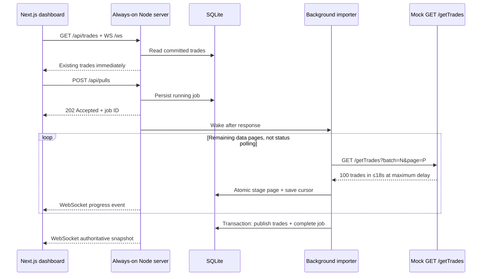

# Architecture note

## Design

The durable job row is the work item. An event wakes a single asynchronous consumer after the HTTP response. No cron, scheduler, browser polling, or job-status polling runs. Startup also wakes any saved unfinished job. Awaiting the mock's HTTP response does not block the Node event loop. A thread pool, Redis, and a separate worker process add no required capability at this assessment's scale.

## Guarantees and failure behavior

- **Independent reads:** only committed trades appear in the dashboard; staging remains private until a complete pull succeeds.
- **Durable progress:** a page and its next-page cursor share one SQLite transaction. Restart resumes at the first uncommitted page.
- **Atomic completion:** staged trades, job completion and staging cleanup commit together. Failure rolls back the publication.
- **Idempotent data:** immutable batch snapshots, deterministic trade IDs, and primary-key conflict handling prevent retry duplicates. A unique partial index permits one running job. Duplicate clicks reuse it.
- **Bounded I/O:** 50 data pages divide a maximum 900,000 ms delay into 18,000 ms per page. The importer has a 25-second request timeout and the server simulates the 30-second absolute HTTP cutoff. JSON responses close their HTTP connection, so keep-alive cannot accumulate a connection age beyond the deadline across pages. WebSocket upgrades use their own persistent transport.
- **Bounded retry:** a failed data request is attempted up to three times, with short backoff; this is data retry, not polling. Invalid data fails before staging. A failed pull retains the old dataset and displays an actionable error.
- **Reconnect consistency:** the socket sends a complete current snapshot on connection. Since publication and snapshot construction execute synchronously in this one Node process, no subscribe/read race can hide a completed job. Slow sockets with excessive buffered output are disconnected and recover via a fresh snapshot.
- **Liveness:** WebSocket ping/pong detects dead connections. It carries no trade-status requests. Browser reconnect backoff only restores transport; it does not poll data.

## Essential assumptions

1. The upstream supports bounded paginated reads from an immutable snapshot. This is an explicit extension to the screenshot's blocking mock endpoint. A worker cannot defeat a network-enforced deadline on an unchanged 15-minute response.
2. WebSocket upgrades and persistent upgraded connections are permitted. SSE remains HTTP and is unsuitable as an indefinitely open connection under an absolute HTTP lifetime limit.
3. One application process owns the SQLite file and event fan-out, with a persistent disk and stable configuration. Recovery begins when that process restarts; no service manager is supplied here.

SQLite and full snapshot delivery are appropriate for the requested few thousand trades. Change storage and transport only when scale, multi-tenancy, or deployment requirements justify it. See the [research](RESEARCH.md) for evidence and alternatives.
